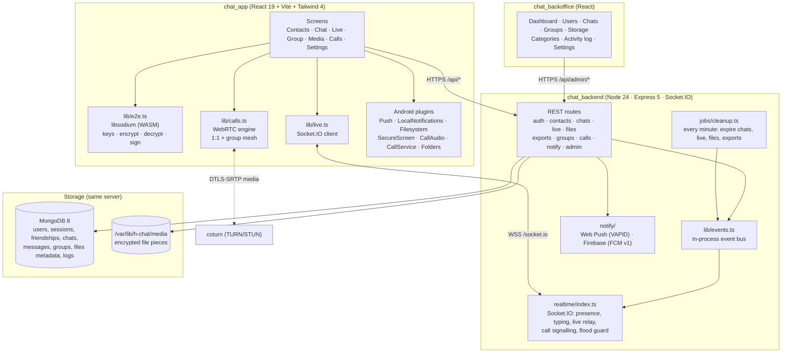
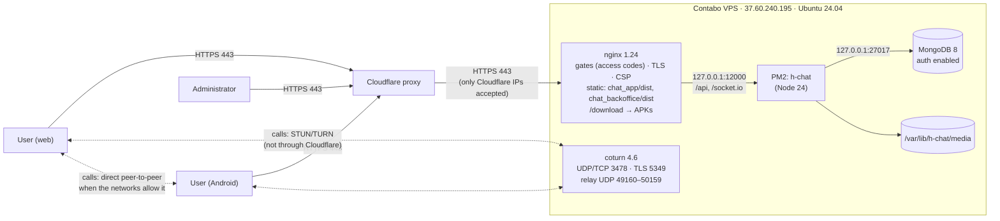
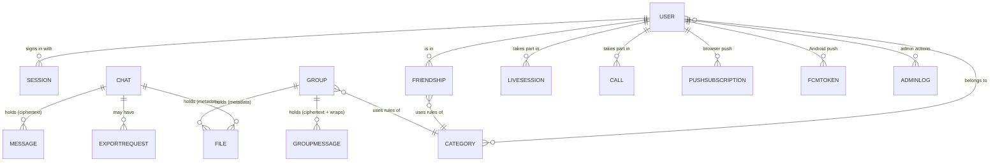

# 1. Architecture

## 1.1 The three applications

| Application | Repository | Runs where | Role |
|---|---|---|---|
| **Backend** | `chat_backend` | Server, PM2 process `h-chat` on `127.0.0.1:12000` | REST API, Socket.IO real-time hub, background jobs, push notifications, TURN credentials |
| **Chat app** | `chat_app` | The user's browser (served from `/projects/chat_app/dist`) and the Android app (same code packaged with Capacitor) | Everything the user sees; **all encryption and decryption**; WebRTC calls |
| **Backoffice** | `chat_backoffice` | The administrator's browser (served from `/projects/chat_backoffice/dist`) | Approve accounts, categories and rules, groups, storage, chats metadata, settings, activity log |

The web app and the Android app are **the same React code**. Capacitor wraps it in an Android WebView and adds a
few native plugins (notifications, files, screenshots blocking, call audio routing, a call service).

## 1.2 Component diagram



## 1.3 Deployment view



Notes:

- **Cloudflare** proxies only the web traffic (chat and backoffice). Calls never go through Cloudflare: the TURN
  server is reached directly on its own ports.
- **nginx gates**: chat.omranisystems.com and adminchat.omranisystems.com first ask for an access code
  (shared `omranisystems` gate service); the Android app talks to `/api` directly with its own session token.
- The backend and MongoDB listen **only on 127.0.0.1**: they can't be reached from the internet.

## 1.4 Data model (MongoDB collections)



| Collection | Holds | Content readable by the server? |
|---|---|---|
| `users` | username, email, Argon2id password and passcode hashes, status, categories, public identity key, preferences | n/a (account data) |
| `sessions` | one active session per account, device info | n/a |
| `friendships`, `invites`, `blocks` | the contact graph | n/a |
| `categories`, `settings` | rules (modes, retention, files, export, calls), minimum app version | n/a |
| `chats` | participants, mode, retention, **public** chat keys, status, counters | no secrets |
| `messages` | **ciphertext**, nonce, key versions, receipts, expiry | **No** — XChaCha20-Poly1305 ciphertext |
| `groups`, `groupmessages` | members, **public** group keys; per message: ciphertext + the message key wrapped for each member | **No** |
| `files` | kind, size, pieces, expiry, status (name and key are inside the encrypted message) | **No** (pieces on disk are encrypted) |
| `livesessions` | who, when, how long, end reason | Nothing typed is ever stored |
| `calls` | who, when, kind, end reason | Audio/video never reach the server's application |
| `exportrequests` | who asked, answer, dates | The zip is built on the phone |
| `adminlogs`, `deviceevents` | audit trails (90 days) | n/a |

Expiry is enforced by MongoDB TTL indexes (`expiresAt`, `purgeAt`) and by the per-minute cleanup job.

## 1.5 Code layout

```
chat_backend/src
  app.ts                 Express app: helmet, CORS, rate limits, routers
  server.ts              start-up, migrations, Socket.IO, jobs
  realtime/              Socket.IO hub + presence
  modules/
    auth/ contacts/ chats/ live/ files/ exports/ groups/ calls/ notify/ me/
    admin/               backoffice API: routes.ts mounts one file per section
                         (users, contacts, chats, groups, storage, live, categories, logs, settings) + context.ts
    docs/                serves this documentation behind its access code
  models/                Mongoose schemas
  jobs/cleanup.ts        expiry every minute (files hourly)
  docs/                  MILESTONES.txt, SECURITY_REVIEW.md, TROUBLESHOOTING.md
chat_backend/documentation
  src/*.md               this documentation (Markdown + Mermaid)
  build.mjs              renders it to site/ (static HTML, diagrams as SVG)

chat_app/src
  app/App.tsx            screens, socket connection, notifications, routing
  lib/e2e.ts             all cryptography (libsodium)
  lib/calls.ts           WebRTC engine (1:1 + group mesh)
  lib/files.ts           encrypted upload/download in pieces
  lib/groups.ts          group keys and recipients
  pages/ components/     UI
chat_app/android/app/src/main/java/com/omranisystems/hchat/
  MainActivity, SecureScreenPlugin, FoldersPlugin, CallAudioPlugin, CallService

chat_backoffice/src/pages
  Dashboard Users UserDetails Chats LiveSessions Groups Storage Categories Logs Settings
```
