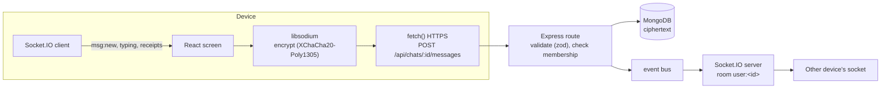

# 2. Technology stack

## 2.1 Overview

| Layer | Technology | Version | Why |
|---|---|---|---|
| Server OS | Ubuntu Server | 24.04.5 LTS | Long-term support |
| Runtime | Node.js | 24 | One language (TypeScript) across server and clients |
| API | Express | 5.3 | Mature, small; async error handling built in |
| Real-time | Socket.IO | 4.8 | WebSocket with automatic reconnection, rooms per user and session |
| Database | MongoDB 8.0 + Mongoose 9 | 8.0 / 9 | Flexible documents, TTL indexes for automatic expiry |
| Validation | zod | 4.6 | Every request body and query is parsed before use |
| Auth | jsonwebtoken (HS256), argon2 (Argon2id), cookie-parser | 9 / 0.45 | Sessions, password and passcode hashing |
| Security middleware | helmet, cors, express-rate-limit | 8 / — / 8.7 | Headers, origins, request limits |
| Push | web-push (VAPID), Firebase Cloud Messaging HTTP v1 | — | Browser and Android notifications |
| Process manager | PM2 | — | Restarts, logs (`pm2-logrotate`) |
| Reverse proxy | nginx | 1.24 | TLS, access-code gates, CSP, static files, APK downloads |
| CDN / proxy | Cloudflare | — | HTTPS in front of the websites, hides the origin for web traffic |
| Call relay | coturn | 4.6.1 | STUN + TURN (UDP, TCP, TLS) |
| Frontend | React | 19.3 | UI for both web and Android |
| Build | Vite | 8.3 | Fast builds, code splitting (libsodium loaded on demand) |
| Styling | Tailwind CSS | 4.3 | Design tokens shared with the backoffice |
| Android | Capacitor | 8.5 | Same web code in a native shell + native plugins |
| Cryptography | libsodium (`libsodium-wrappers`, WebAssembly) | 0.7.15 | Audited primitives, same code on web and Android |
| Calls | WebRTC (browser / Android System WebView) | — | Built-in, standard, encrypted media |
| Zip export | fflate | 0.8.3 | Builds the export zip on the device |
| Tests | Vitest 5, Testing Library, Supertest, Playwright | — | Unit, API and real-browser scenarios |

## 2.2 Chat stack



- **Stored messages** go through HTTPS (`POST`), are saved as ciphertext, and are pushed to the recipient's open
  apps through Socket.IO (`msg:new`). Closed apps get a notification (Web Push or Firebase).
- **Live chat** never touches the database: each keystroke is encrypted on the device and **relayed** by
  Socket.IO to the other side (`live` event).
- **Files** are encrypted on the device in 4 MiB pieces and uploaded with `PUT /api/files/:id/chunks/:n`.

## 2.3 Call stack

| Piece | What it is | Where it runs |
|---|---|---|
| **WebRTC** | The browser's / WebView's real-time media engine | On each device |
| **Opus** | Audio codec (negotiated by default; ~6–64 kbit/s, adapts to the network) | On each device |
| **VP8 / VP9 / H.264** | Video codecs (negotiated automatically between the two devices) | On each device |
| **DTLS-SRTP** | Mandatory WebRTC encryption of all audio and video packets | Between the devices |
| **ICE** | Finds a path between two devices: direct (host/STUN) or through the relay (TURN) | Devices + coturn |
| **STUN** | Tells a device its public address (`stun:turn.omranisystems.com:3478`) | coturn |
| **TURN** | Relays the encrypted packets when no direct path exists (mobile data, strict Wi-Fi) | coturn (UDP/TCP 3478, TLS 5349) |
| **Signalling** | Exchange of offers/answers/candidates, **signed with each person's identity key** | Socket.IO through the backend |
| **Ringing** | `call:incoming` on the socket; Firebase "Incoming call" when the Android app is closed | Backend |

### Noise and echo: which service reduces noise in calls?

H_CHAT uses the **audio processing built into WebRTC** (the WebRTC "Audio Processing Module", the same one
Google Meet and most web calling apps rely on). There is no external or cloud noise service: processing happens
**on the device**, before the sound is encrypted, so no audio ever leaves the device unencrypted.

The microphone is opened with:

```js
navigator.mediaDevices.getUserMedia({
  audio: { echoCancellation: true, noiseSuppression: true },  // autoGainControl: on by default
  video: kind === "video" ? { facingMode: "user" } : false,
});
```

| Feature | What it does | Provided by |
|---|---|---|
| **Noise suppression** | Removes steady background noise (fans, traffic, hum) from your voice | WebRTC APM (Chromium / Android System WebView) |
| **Echo cancellation (AEC)** | Removes the other person's voice that your microphone picks up from your speaker, so they don't hear themselves | WebRTC APM |
| **Automatic gain control (AGC)** | Keeps your voice at a steady level whether you whisper or are close to the mic | WebRTC APM (default on) |
| **Opus codec** | Built-in packet-loss concealment and bandwidth adaptation on bad networks | WebRTC |
| **Android call mode** | `AudioManager.MODE_IN_COMMUNICATION`: the phone's voice-call audio path (and its hardware echo/noise processing where the phone has it) | `CallAudioPlugin` (native) |

On Android the sound goes, in this order, to: a connected headset or earbuds → the phone's earpiece → the
loudspeaker (only when the user taps it). The screen turns off at the ear (proximity sensor), and a foreground
service (`CallService`) keeps the microphone running with the screen off.

## 2.4 Notifications stack

| Situation | Channel | What the provider sees |
|---|---|---|
| App open on screen | Socket.IO `notify` event → in-app banner | — |
| Android app in background or closed | Firebase Cloud Messaging (HTTP v1, service account) | "H_CHAT · New message", "Incoming call"… never names or content |
| Browser tab closed | Web Push (VAPID keys) via the browser's push service | Nothing readable: the payload (sender name + "New message", never content) is encrypted for that browser (RFC 8291) |

## 2.5 Android native pieces

| Plugin / service | Purpose |
|---|---|
| `@capacitor/push-notifications` | Firebase registration, notification taps |
| `@capacitor/local-notifications` | Phone notifications while the app runs in the background |
| `@capacitor/filesystem`, `@capacitor/share` | Save to Documents/H_CHAT, share files |
| `SecureScreenPlugin` | `FLAG_SECURE`: no screenshots while a view-only file is shown |
| `CallAudioPlugin` | Call audio mode, output choice (earpiece / speaker / headset), proximity screen-off |
| `CallService` | Foreground service "call in progress" (microphone/camera with screen off) |
| `FoldersPlugin` | Opens Documents/H_CHAT in the Files app |
