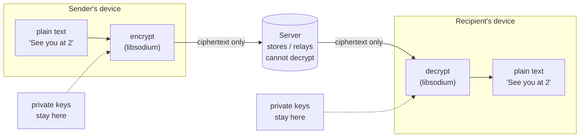
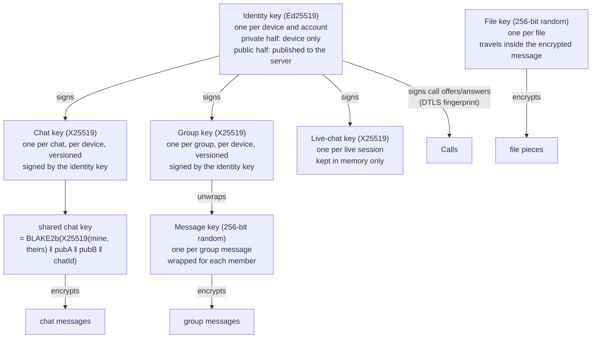
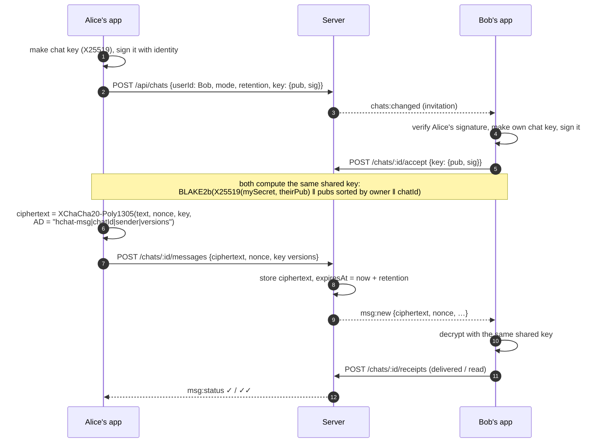
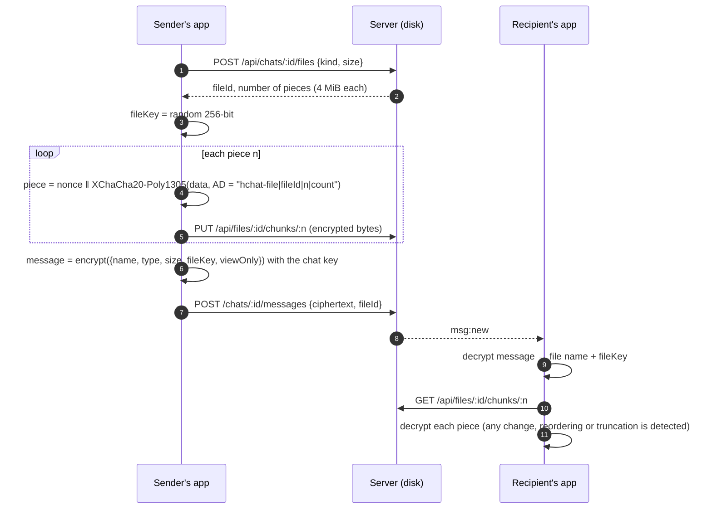
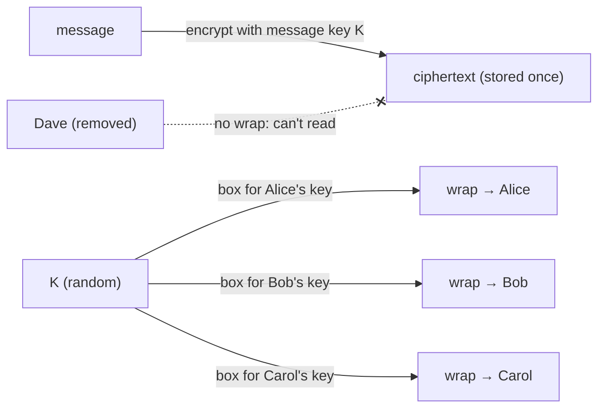
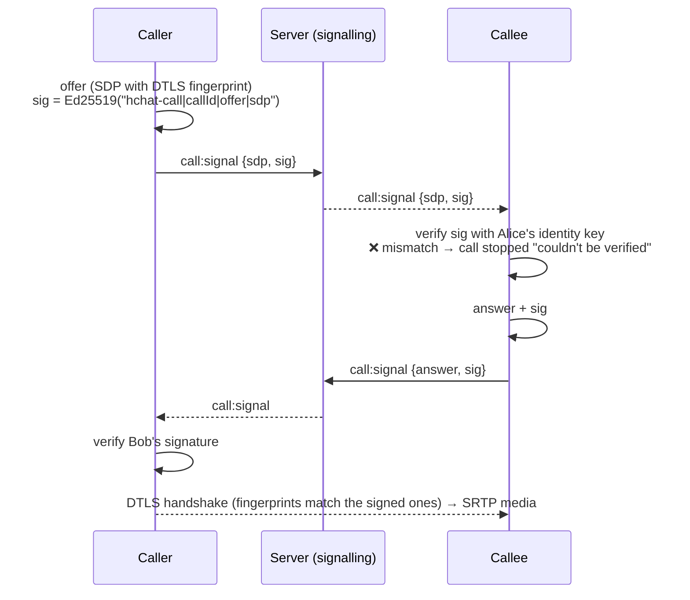

# 3. Encryption

## 3.1 The short answer

**Encryption happens on the endpoints: the phones and the computers. Never on the server.**

- Every message, file, live-chat keystroke and group message is encrypted **inside the H_CHAT app on the
  sender's device** (browser or Android) and decrypted **inside the app on the recipient's device**.
- The private keys are created on the device and **never leave it**. The server only ever receives *public* keys.
- The server stores and forwards **ciphertext**. It cannot read it, and neither can the administrator, Cloudflare,
  Google (push) or anyone who copies the database or the disk.
- Calls are encrypted by WebRTC (DTLS-SRTP) **between the devices**; each side signs its connection parameters
  with its identity key, so the server can't secretly insert itself in the middle.

## 3.2 Library and algorithms

All cryptography uses **libsodium** (compiled to WebAssembly, `libsodium-wrappers` 0.7.15), the same code in the
browser and in the Android app. Nothing is hand-rolled.

| Purpose | Algorithm | libsodium function |
|---|---|---|
| Identity (signatures) | **Ed25519** | `crypto_sign_keypair`, `crypto_sign_detached`, `crypto_sign_verify_detached` |
| Key agreement | **X25519** (Curve25519 Diffie-Hellman) | `crypto_box_keypair`, `crypto_scalarmult` |
| Key derivation | **BLAKE2b** (256-bit) | `crypto_generichash` |
| Message / file / live encryption | **XChaCha20-Poly1305** (AEAD, 192-bit random nonce) | `crypto_aead_xchacha20poly1305_ietf_*` |
| Group key wrapping | **X25519 + XSalsa20-Poly1305** (authenticated box) | `crypto_box_easy`, `crypto_box_open_easy` |
| Safety code | BLAKE2b over both identity keys → 12 groups of 5 digits | `crypto_generichash` |
| Calls | **DTLS 1.2/1.3 + SRTP** (AES-GCM / AES-CM), negotiated by WebRTC | browser / WebView |
| Passwords (server side, not E2E) | **Argon2id** | `argon2` (Node) |

## 3.3 The keys

| Key | Created | Stored (private half) | What the server gets |
|---|---|---|---|
| Identity (Ed25519) | First sign-in on a device | Device storage (`localStorage` in the web app / WebView) | Public key only |
| Chat key (X25519) | When starting or accepting a chat; again on a new device | Device storage, per chat and version | Public key + signature |
| Group key (X25519) | When opening a group the first time on a device | Device storage | Public key + signature |
| Live key (X25519) | When inviting / accepting a live chat | **Memory only** (gone when the app closes) | Public key + signature |
| File key | For each file sent | Inside the encrypted message | Nothing |
| Message key (groups) | For each group message | Nowhere: wrapped for each member | Wrapped copies (unreadable) |

**Signing chat keys** prevents the server from swapping a chat key for its own: each published key is signed
with the owner's identity key over `"hchat-chat-key|owner|peer|publicKey"`, and the other side verifies it.

## 3.4 Stored (Keep-alive / Automatic) chats

- The **associated data** binds every ciphertext to its chat, sender and key versions: a message can't be moved
  to another chat or attributed to someone else without decryption failing.
- **New device**: the app publishes a new chat key version; older messages stay readable only on the old device.
- **Ending a chat** deletes the server's ciphertext *and* the devices' private chat keys: what's left can never be
  decrypted again.
- **Safety code**: 12 groups of 5 digits computed from both identity keys. If both people see the same digits, no
  one is in between (the server can't fake it without being caught).

## 3.5 Files

The file's **name, type and key exist only inside the encrypted message**. On disk the server has numbered pieces
of random-looking bytes (verified in testing: no piece contains readable data).

## 3.6 Live chats

The same key agreement as stored chats, with three differences: the private live key lives **in memory only**,
nothing is ever written to the database, and each keystroke is encrypted as
`{t: "draft"|"line", text, n}` with AD `"hchat-live|sessionId|sender"` and relayed by Socket.IO. Files in a live
chat are sent in 32 KB encrypted pieces through the same relay and never stored.

## 3.7 Groups

Each member publishes a signed group key. For every message the sender:

1. makes a random **message key**;
2. encrypts the message once with it (XChaCha20-Poly1305, AD `"hchat-gmsg|groupId|sender|version"`);
3. **wraps** the message key for each current member's group key with `crypto_box` (X25519 + XSalsa20-Poly1305,
   authenticated by the sender's group key).

- The server **refuses** a message that isn't wrapped for every member who has a key, so no member is silently
  left out.
- When someone **leaves or is removed**, their keys are deleted from the group; new messages are never wrapped for
  them, so they **can't read anything sent afterwards**. (What they received before stays on their device until it
  expires.)
- Each member only ever receives **their own** wrap from the server.

## 3.8 Calls

WebRTC encrypts all audio and video with **DTLS-SRTP**, end to end between the devices (or between the device and
the other device *through* the TURN relay: the relay forwards encrypted packets it cannot decrypt).

The weak point of plain WebRTC is that the DTLS fingerprints travel through the signalling server, which could
swap them. H_CHAT closes that gap:

The call screen also shows the first two groups of the safety code ("encrypted · 48213 77019") so people can
compare them aloud.

## 3.9 What the server can and can't see

| The server **can** see (metadata) | The server **cannot** see |
|---|---|
| Accounts, emails, contact lists, categories | Message text |
| Who chats with whom, when, how often | File names, file types (only a coarse "image/video/document"), file content |
| Message and file sizes, expiry times | Live-chat keystrokes |
| Read receipts, typing indicators | Group message content |
| Call participants, start/end times, direct or relayed | Call audio and video |
| IP addresses and device info (security log) | Private keys of any kind |

Notification providers: **Google Firebase** (Android) receives only generic texts like "H_CHAT · New message" or
"Incoming call". **Browser push services** receive a payload encrypted for the user's browser (Web Push, RFC 8291)
that they can't read; it holds the sender's name and "New message", never the message itself.

## 3.10 Limits of the encryption (honest view)

- **Private keys are stored in the app's storage** (`localStorage` in the browser / the WebView's storage on
  Android), not in a hardware keystore. Malware on the device, or a cross-site-scripting bug in the web app, could
  read them. Mitigations: strict Content-Security-Policy (no third-party scripts), React escaping, no `eval`.
- **No forward secrecy per message** (no Double Ratchet as in Signal): one chat key per chat and device. Messages
  are short-lived (max 7 days) and ending a chat destroys the keys, which limits exposure.
- **Trust in the server for public keys** on first contact (like most messengers): comparing the safety code
  removes that trust.
- **The web app code itself is served by the server.** A compromised server could serve modified JavaScript. The
  Android app is signed and doesn't have this problem.
- **Metadata is visible** to the server (see 3.9).
