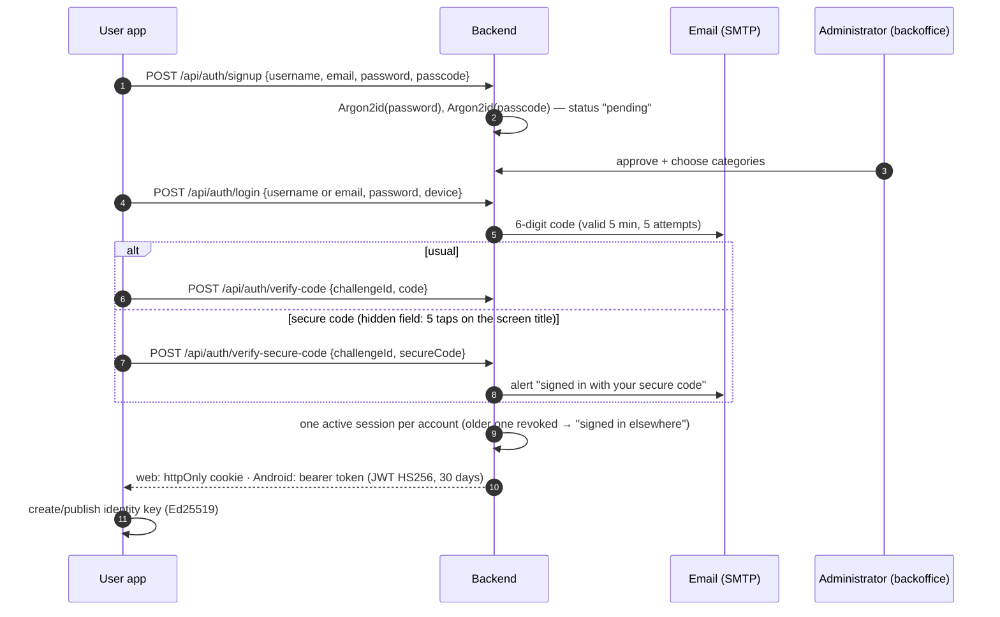
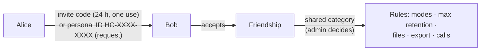
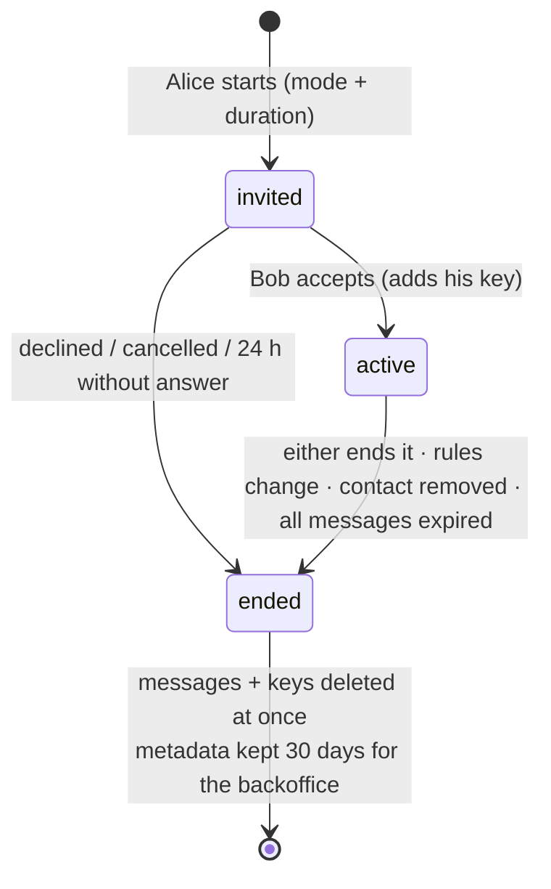
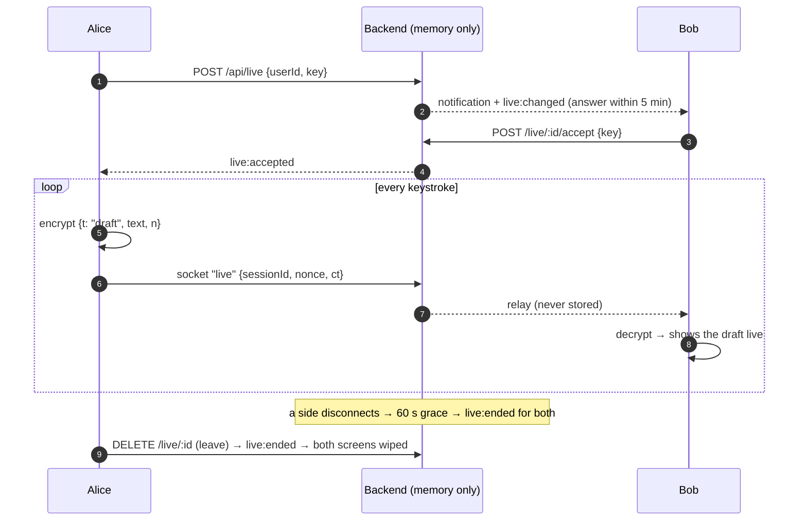
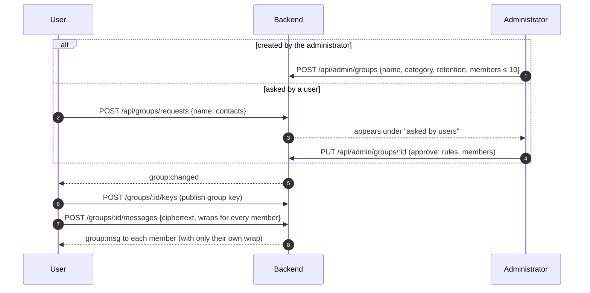
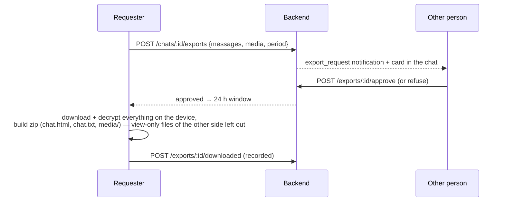
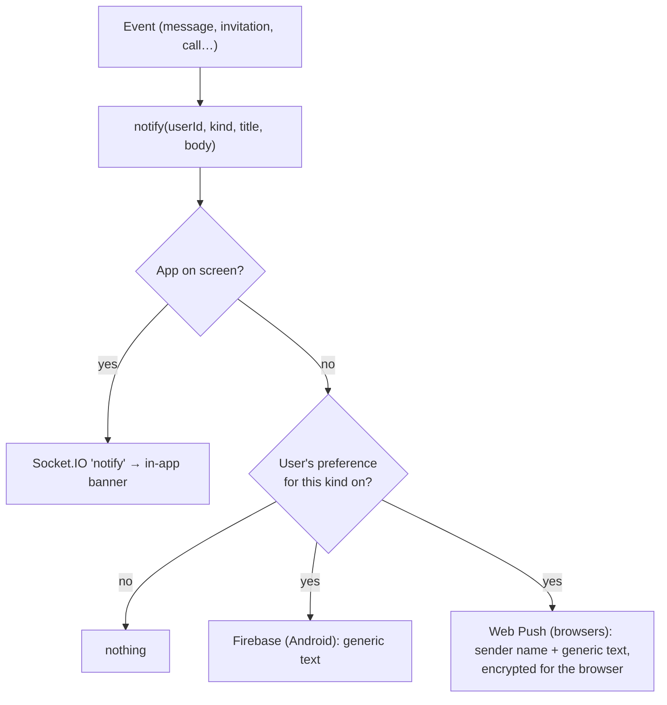

# 4. How chats work

## 4.1 Accounts and sign-in

- **Secure code (1.1.0):** each person may set their own 8–12-digit code in Settings (current password required).
  On the "Check your email" screen, 5 taps on the title within 3 seconds reveal a field where it replaces the
  emailed code. The password step is still required; wrong codes count toward the lock; every use sends an alert
  email and appears in the security log; any credentials reset erases it; the administrator can switch it off per user.
- Lost email access: the **8-digit recovery passcode** replaces the email code once, then forces new credentials.
- Too many wrong attempts lock the account for 30 minutes.
- Socket.IO connections use a 60-second **socket ticket** (web) or the bearer token (Android).

## 4.2 Contacts and categories

- Two people can only be contacts if the administrator put them in **at least one common category**.
- The category decides what they may do: Live / Keep-alive / Automatic, how long messages stay (30 min–7 days),
  files, export, calls.
- ID searches are limited to 10 per hour. Blocking is silent and permanent.

## 4.3 Chat modes

| Mode | Stored on the server? | Lifetime | Notes |
|---|---|---|---|
| **Keep-alive** | Yes, encrypted | Each message: 30 min … 7 days (category maximum) | Chosen when starting, can't change |
| **Automatic** | Yes, encrypted | Each message: 7 days | |
| **Live** | **Never** | While both are connected | Letter-by-letter typing; wiped when either leaves or after 1 minute without connection |

## 4.4 Stored chat lifecycle

## 4.5 Live chat

## 4.6 Groups

Members can leave; the administrator adds and removes people. Export and live chat aren't available in groups.

## 4.7 Export (approval-based)

## 4.8 Notifications

## 4.9 Expiry and cleanup

| What | When it goes |
|---|---|
| Messages | At `expiresAt` (MongoDB TTL index) |
| Files | Every minute: expired, abandoned uploads (1 h), admin deadlines; on chat end; by sender/recipient |
| Chats | Invitation unanswered 24 h; all messages expired; ended chats' metadata after 30 days |
| Live chats | Invitation 5 min; 60 s without connection |
| Export approvals | 24 h |
| Admin and security logs | 90 days |
