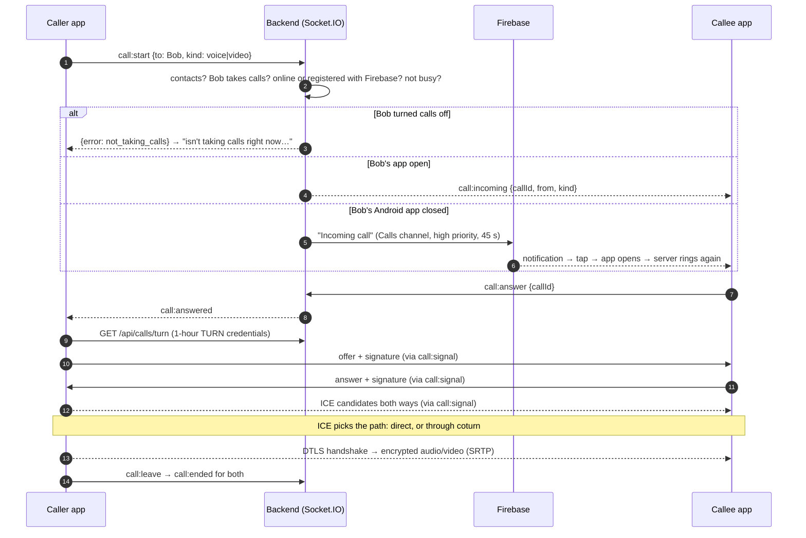
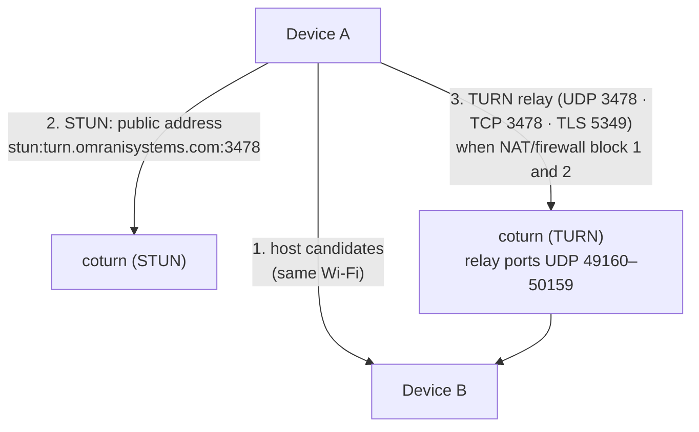
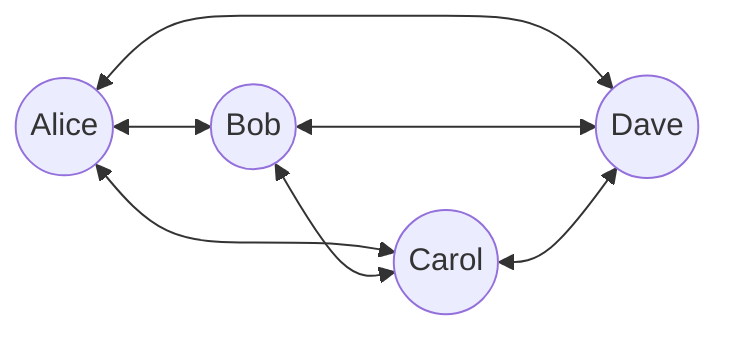
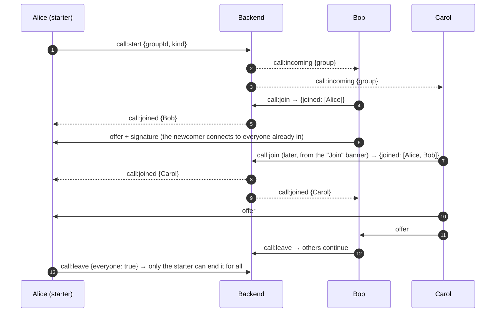

# 5. How calls work

## 5.1 Principles

- Calls use **WebRTC**, built into browsers and the Android System WebView.
- Audio and video go **directly between the devices** whenever the networks allow it. Otherwise they go **through
  the TURN relay** on the H_CHAT server, still encrypted (DTLS-SRTP): the relay forwards packets it can't read.
- The backend only does **signalling** (ringing, offers/answers, network candidates) over Socket.IO. It never
  receives audio or video.
- Every offer and answer is **signed with the caller's/callee's identity key** and verified by the other side
  (see [Encryption §3.8](03-encryption.md#38-calls)).

## 5.2 1:1 call

Unanswered after **45 seconds** → missed call (notification). If one side loses its connection for **15 seconds**
the call ends on both sides; if a device loses its socket for **30 seconds** the server ends its calls.

## 5.3 Finding a path: direct or relayed

| Network situation | Typical path |
|---|---|
| Both on Wi-Fi at home / office | Direct |
| One on mobile data (carrier NAT) | Often relayed |
| Strict company Wi-Fi blocking UDP | Relayed over TCP or TLS 5349 |

The call screen shows **"direct"** or **"through the relay"**.

TURN credentials are short-lived (1 hour) and per user: `username = "<expiry>:<userId>"`,
`password = HMAC-SHA1(TURN_SECRET, username)` (coturn `use-auth-secret`). The relay refuses to forward to private,
loopback and multicast addresses (`denied-peer-ip`), so it can't be used to reach the server's internal network.

## 5.4 Group calls (up to 6 people)

Group calls use a **mesh**: every device connects to every other device. There's no media server.

Rules: maximum **6 people at once** (the 7th sees "Full"); members can join while it runs; the call ends when the
starter ends it for everyone, or when only one person is left; nobody joins within 45 s → missed.

## 5.5 Audio quality: noise, echo and routing

| Stage | Where | What |
|---|---|---|
| Capture | Device | `getUserMedia` with **noise suppression**, **echo cancellation**, **automatic gain control** (WebRTC Audio Processing Module, on the device) |
| Encode | Device | Opus (adaptive bitrate, packet-loss concealment) |
| Transport | Network | SRTP over UDP (or TCP/TLS through the relay) |
| Playback | Device | Separate `<audio>` element per remote person, restarted if Android pauses it |
| Routing (Android) | `CallAudioPlugin` | Headset/earbuds → earpiece → loudspeaker (on demand); call volume on the volume keys; screen off at the ear |
| Background (Android) | `CallService` | Foreground "call in progress" service keeps the microphone (and camera) with the screen off |

Users can check their devices: in a call, **Sound** shows "their voice" and "your mic" level meters, lets them pick
the output (by name) and the microphone, and plays a test sound. **Settings › Calls › Test microphone and speaker**
records 3 seconds and plays them back.

## 5.6 Settings and rules

- **Receive calls** (per user): off → callers see "isn't taking calls right now… for their own reasons. That's
  their choice: you can still write to them."
- Calls are available in **every category**, voice and video, 1:1 and in groups.

## 5.7 Diagnostics

Each device reports, 5 s / 15 s / 30 s into a call, **numbers only** to the server log (`"call audio"`): bytes and
packets received, audio energy, player state, output route, direct/relayed. No audio is ever sent. This is how
the Android earpiece and paused-player problems were found and fixed.
