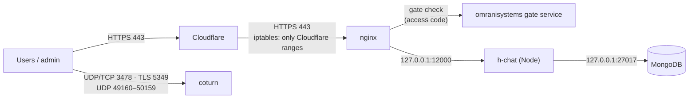

# 6. Hosting and operations

## 6.1 Where the server is

| | |
|---|---|
| Provider | **Contabo GmbH** (AS51167), virtual private server |
| Location | **France**, Grand Est (Lauterbourg), Europe/Paris time zone |
| Public IP | 37.60.240.195 (`vmi3665458.contaboserver.net`) |
| Machine | KVM virtual machine, **4 vCPU**, **7.8 GB RAM**, **96 GB SSD** (17% used at release) |
| OS | Ubuntu 24.04.5 LTS, kernel 6.8 |
| Shared with | Other omranisystems apps (portfolio, it, ai, gym, password manager, monitoring), each its own PM2 process |
| DNS / CDN | Cloudflare (web traffic proxied; `turn.omranisystems.com` resolves directly to the server) |
| TLS | Let's Encrypt certificates (certbot renewal), Cloudflare in front for the websites |

Because the server is in France (EU), data at rest (encrypted messages, metadata, accounts) is stored in the EU.

## 6.2 Network path

| Port | Service | Exposed to |
|---|---|---|
| 443 / 80 | nginx (websites, API, Socket.IO, APK downloads) | Cloudflare only (iptables `CF_WEB` chain) |
| 3478 UDP/TCP, 5349 TLS | coturn STUN/TURN | Internet |
| 49160–50159 UDP | coturn relay ports | Internet |
| 12000 | h-chat backend | 127.0.0.1 only |
| 27017 | MongoDB (authentication enabled) | 127.0.0.1 only |
| 22 | SSH | Internet (shared server) |
| 3389 | RDP (kept open at the owner's request) | Internet (shared server) — see [Security](08-security.md) |

## 6.3 nginx

- `chat.omranisystems.com`: gate (code), static `chat_app/dist`, `/api/` and `/socket.io/` → `127.0.0.1:12000`,
  `/download/` → `/projects/mobile_builds/h_chat` (APK + `latest.json`, readable by the app from `https://localhost`),
  `/api/admin` blocked, `/documentation` → `127.0.0.1:12000` (gate, then the documentation access code).
- `adminchat.omranisystems.com`: gate (code), static `chat_backoffice/dist`, only `/api/admin/` proxied.
- Security headers: Content-Security-Policy (`default-src 'self'; script-src 'self' 'wasm-unsafe-eval'; frame-ancestors
  'none'; …`), `X-Frame-Options DENY`, `nosniff`, `Referrer-Policy same-origin`.

## 6.4 Processes and files

| What | Where |
|---|---|
| Backend process | PM2 `h-chat` → `node dist/server.js` (cwd `/projects/chat_backend`) |
| Backend config | `/projects/chat_backend/.env` (Mongo URI, JWT secrets, SMTP, TURN secret, VAPID keys) |
| Encrypted file pieces | `/var/lib/h-chat/media/<fileId>/<n>` |
| APKs | `/projects/mobile_builds/h_chat/` (`h_chat-<version>.apk`, `latest.json`) |
| Android signing key | `/root/.chat-keystore/` (password in `/root/ACCESS.txt`) |
| Firebase server key | `/root/.hchat/firebase-service-account.json` (chmod 600, not in git) |
| TURN config | `/etc/turnserver.conf` (shared secret = backend `TURN_SECRET`) |
| Secrets index | `/root/ACCESS.txt` |
| Logs | `pm2 logs h-chat` (JSON, pino), rotated by `pm2-logrotate`; nginx `/var/log/nginx/` |

## 6.5 Deploying

| Component | Command |
|---|---|
| **Everything** (backend, backoffice, web app + APK) | `bash /projects/hchat-deploy.sh` (patch) · `bash /projects/hchat-deploy.sh minor` (milestone) |
| Backend | `cd /projects/chat_backend && npm run build && pm2 restart h-chat` |
| Chat app (web + APK) | `cd /projects/chat_app && npm run release` (tests → version bump → web build → signed APK → publish). `-- minor` / `-- major` for milestones |
| Backoffice | `cd /projects/chat_backoffice && npm run build` |

Phones see an **"Update available"** card when a newer APK is published; the backoffice's **minimum app version**
can force an update ("Update required").

## 6.6 Backups

| What | Current state | Recommended |
|---|---|---|
| MongoDB, media, secrets, configs | Server-wide `/projects/backup.sh`, **every night at 03:00** (root cron): one encrypted archive in `/projects/backup/OS/` (7 kept) with Mongo dumps, `/var/lib/h-chat`, `.env` files and keys. Restore: `/projects/restore.sh` (README in `/projects/backup/OS/`) | The archives stay on the server; the owner downloads copies (WinSCP). Keep doing that regularly (Security, risk R1) |
| Settings | Backoffice › Settings › **Download a backup** (categories, rules, groups) | Keep a copy after each change |
| Code and this documentation | GitHub (`main`, tags `v1.0.0` … `v1.1.1`) | — |

## 6.7 Monitoring

- `GET /api/health` for liveness; PM2 restarts the process if it crashes.
- The omranisystems **monitoring** app (monitoring.omranisystems.com) runs on the same server.
- Backoffice dashboard: accounts, chats, online sessions, storage, disk usage (uploads stop at 80% disk).
