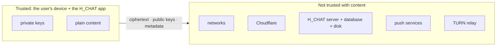

# 8. Security

This document summarises the security design, the controls in place and the remaining risks. The full release
review is in `chat_backend/docs/SECURITY_REVIEW.md`.

## 8.1 Threat model

| Adversary | Can they read messages, files or calls? | Why |
|---|---|---|
| Someone listening on the network (Wi-Fi, ISP) | **No** | TLS for web traffic, DTLS-SRTP for calls, plus end-to-end encryption |
| Cloudflare | **No** | Sees HTTPS traffic in clear at its edge, but the content is already end-to-end encrypted |
| Google (Firebase) / browser push services | **No** | Generic texts / payloads encrypted for the browser |
| Someone who steals the database or disk | **No** for content | Ciphertext only; passwords Argon2id-hashed. Metadata **yes** |
| The administrator | **No** for content | The backoffice shows metadata only; can delete, not read |
| A malicious or compromised server | **Not passively.** Could try to swap keys (detected by signatures and the safety code), or serve modified web-app code (Android app not affected) | |
| Malware on a user's device | **Yes** | Endpoint compromise defeats any messenger's encryption |
| Another user | Only what's sent to them | Contacts must share a category; blocking; view-only files |

## 8.2 Controls in place

| Area | Control |
|---|---|
| Accounts | Admin approval; Argon2id for passwords and recovery passcodes; email code (6 digits, 5 min, 5 attempts) or the user's own secure code (Argon2id, alert email on each use, admin switch); 30-min lock after repeated failures; one session per account; security log visible to the user |
| Sessions | JWT HS256 with pinned algorithm; separate user/admin secrets; user 30 days, admin 2 h; web cookie `httpOnly; Secure; SameSite=Strict`; socket tickets 60 s |
| Access control | Every admin route requires an admin session; user routes check membership (chat, group, file) |
| Input | zod validation on every body and query; 64 KB JSON limit; exact-size file pieces |
| Transport | HTTPS everywhere (Cloudflare + Let's Encrypt), WSS, TURN over TLS available |
| Content | End-to-end encryption (Encryption doc); signed keys; safety codes; signed call offers |
| Web app | CSP `script-src 'self' 'wasm-unsafe-eval'`, no third-party scripts, `frame-ancestors 'none'`, nosniff |
| Server | Backend and MongoDB on 127.0.0.1; MongoDB auth; web ports open to Cloudflare only; access-code gates in front of both sites |
| Abuse | Per-session/per-address rate limits; sign-in/sign-up limits; socket flood guard; ID search limit |
| Files | Paths only from validated ids; 2 GB quota; disk guard; automatic expiry |
| TURN | Short-lived HMAC credentials; private/loopback/multicast destinations denied; TLS 1.0/1.1 disabled |
| View-only | Android blocks screenshots/recording (`FLAG_SECURE`); web deters (no right-click/drag/print, blur when unfocused) |
| Updates | "Update available" card; administrator-set minimum version blocks old apps |
| Dependencies | `npm audit`: 0 known vulnerabilities at 1.0.0 |
| Audit | Every admin action logged (90 days), filterable |

## 8.3 Risks and recommendations

Ranked by importance (likelihood × impact).

| # | Risk | Impact | Recommendation |
|---|---|---|---|
| **R1** | **Backups are nightly but stay on the same server** (`/projects/backup.sh`, 03:00, encrypted, 7 kept); copies off the server are manual downloads | If the VPS is lost, data since the last downloaded copy is lost | Download the latest archive regularly; test a full restore with `/projects/restore.sh` on a VM |
| **R2** | **Single server** for everything (web, API, DB, TURN, other apps) | Outage = H_CHAT down; one compromised app on the server could affect others | Separate VPS for H_CHAT (and TURN); provider snapshots |
| **R3** | **RDP (3389) open to the internet** (owner's choice). SSH is key-only with fail2ban since 2026-10-29; 3010/11000 only redirect | Brute-force / exploit entry to the whole server through RDP | Restrict RDP to your IP or a VPN (WireGuard) when possible |
| **R4** | Private keys in app storage (`localStorage` / WebView), not a hardware keystore | Malware or an XSS bug could read keys | Keep strict CSP; consider Android Keystore-wrapped keys; WebCrypto non-extractable keys on web |
| **R5** | Web app code is served by the server | A compromised server could ship modified JavaScript to web users | Recommend the Android app for sensitive use; Subresource Integrity / signed releases; monitor `dist` integrity |
| **R6** | Metadata visible to the server (who/when/sizes/IPs) | Social graph exposure if the DB leaks | Minimise retention of logs; consider sealed-sender-style designs later |
| **R7** | No forward secrecy per message (no Double Ratchet) | A stolen device key reveals that chat's still-stored messages | Short retention already limits it; a ratchet (e.g. Signal protocol / MLS for groups) for v2 |
| **R8** | Secrets in plain files (`.env`, `/root/ACCESS.txt`, Firebase key) | Server compromise exposes them | Keep `chmod 600`; move to a secrets manager; rotate after any incident |
| ~~R9~~ | ~~TURN relay port range small (41 ports)~~ — **fixed 2026-11-11 (M14):** 1,000 ports, 500 allocations | — | Watch bandwidth instead (Limits §7.3) |
| **R10** | Firebase metadata | Google learns that (and when) a phone got a notification | Generic texts already; a self-hosted push alternative (UnifiedPush) if needed |
| **R11** | Gate codes are shared access codes | Leaked code removes one layer (accounts and E2E remain) | Rotate gate codes periodically |
| **R12** | One-time database password exposure in a session log (18 Oct) | Low (stayed on the server) | Rotate the H_CHAT MongoDB password |
| **R13** | Secure code = password **and** code are both things the user knows (no email possession) | Someone who learns both can sign in without the mailbox | Alert email on every use; lock after 5 failures; erased by any reset; admin switch per user; users choose a code different from the passcode |

## 8.4 Incident checklist

1. **Suspected account compromise:** backoffice › Users › *Force sign-out* / *Suspend*; the user changes
   password; their security log shows devices and places.
2. **Server compromise:** rotate `JWT_SECRET`, `ADMIN_JWT_SECRET` (signs everyone out), `TURN_SECRET`, VAPID keys,
   Firebase key (console › service accounts), MongoDB password, gate codes; reinstall from GitHub `v1.0.0`;
   raise the **minimum app version** after a fixed release. Also change the documentation access code
   (`DOCS_CODE_HASH` in `.env`) and the gate codes.
3. **Lost phone:** the user signs in elsewhere (the old session ends); their old device's keys are useless without
   the session; ending sensitive chats destroys their keys everywhere.
4. **Disk filling up:** backoffice › Storage › *Clean up now*, *Ask to download*, or delete media; uploads stop at 80%.
