# 10. UX and UI design

All screenshots on this page come from the real app (version 1.1.1) running against a test database, at
phone size (390 × 844). The web app and the Android app share the same screens.

## 10.1 Design principles

| Principle | What it means in the product |
|---|---|
| **Private by default** | Nothing is public: accounts need approval, contacts are added by ID or one-time invite, chats are invitations the other side accepts. |
| **Say what happens to the data** | Every chat shows its mode badge (`KEEP · 1D`, `AUTO · 7D`, `LIVE`) and each message shows when it will be deleted. Settings explain notifications as "Who wrote. Never what they wrote." |
| **One clear action per screen** | One primary (burgundy) button per screen: *Continue*, *Verify and sign in*, *Add contact*, *Send chat invitation*. |
| **Calm, dark, technical** | Dark surfaces, monospace labels (`// CONTACTS · 1`), little colour: colour carries meaning (mode, status, danger). |
| **Mistakes are hard, destruction is explicit** | Destructive actions use a dashed, bracketed style (`[ END ]`); the most destructive ones ask to type a name. |
| **Same everywhere** | One codebase for web and Android, one set of design tokens shared with the backoffice. |

## 10.2 Visual language

### Colours (design tokens, `chat_app/src/styles.css`)

| Token | Value | Used for |
|---|---|---|
| `bg` · `panel` · `raised` · `sunken` | `#0a0b10` · `#111219` · `#181a24` · `#0d0e14` | Page, cards, hovered rows, inputs |
| `line` · `line-strong` | `#262938` · `#3a3e52` | Borders |
| `ink` · `ink-soft` · `dim` · `faint` | `#f3f4f8` · `#c9ccd8` · `#9ea3b5` · `#6e7387` | Text from most to least important |
| `brand` · `brand-hover` | `#7e2234` · `#942a3f` | Primary buttons, own message bubbles |
| `accent` · `link` | `#c7707e` · `#d99aa5` | Focus rings, links |
| `live` | `#7fdce8` | Live chats (nothing stored) |
| `keep` | `#f2c46b` | Keep-alive chats (deleted N after sending) |
| `auto` | `#9aaeff` | Automatic chats (7 days) |
| `ok` · `online` · `danger` | `#7fe3b6` · `#5fd9a4` · `#ff7a7a` | Success, presence, errors and destructive actions |

### Type, shape, spacing

- **Archivo** (400–800) for text and headings; **JetBrains Mono** for labels, IDs, codes, timestamps.
- Radii: fields 12 px, buttons 14 px, cards 20 px. Touch targets at least 44 px high (most 50–54 px).
- Screens are a single column, max 560 px wide, 16 px side padding: the same layout on a phone and a desktop.

### Components (`chat_app/src/components/`)

| Component | Role |
|---|---|
| `Button` | `primary` (burgundy, one per screen), `secondary` (outlined), `danger` (dashed, bracketed, mono) |
| `TextField`, `CodeInput` | Labelled inputs; the 6-box code input moves focus box to box and accepts paste |
| `Screen` → `AuthScreen`, `Card`, `Notice`, `TextLink` | Sign-in layouts, panels, info/warning/error messages |
| `PageHeader` | Back arrow + title on every inner screen |
| `ModeBadge` | `LIVE` / `KEEP · 1D` / `AUTO · 7D` pills in the mode colours |
| Sheets (`StartChatSheet`, `AttachSheet`, `ExportSheet`, `NewGroupSheet`) | Bottom sheets for multi-step choices |
| `Banners`, `UpdatePrompt` | In-app notifications, "Update available / required" |
| `CallScreen` | Full-screen call UI with device pickers |

## 10.3 Screens

### Signing in

| Sign in | Request access | Email code |
|---|---|---|
| 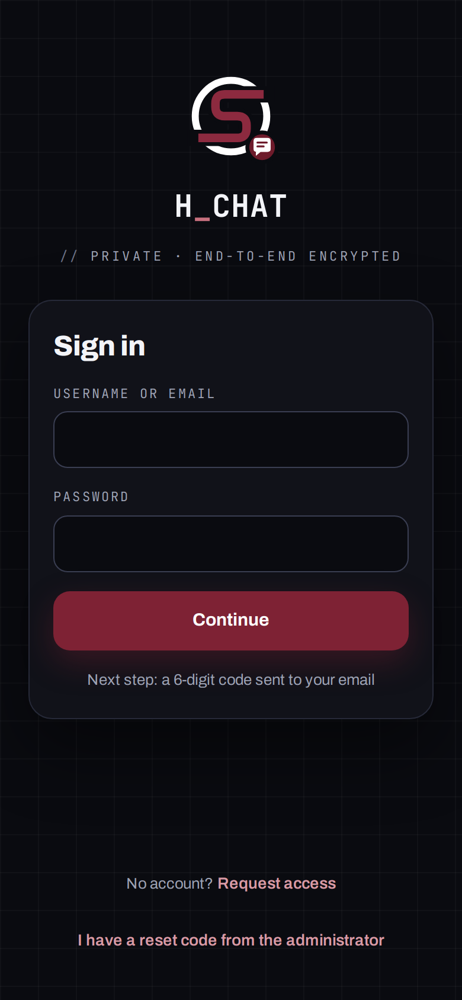 | 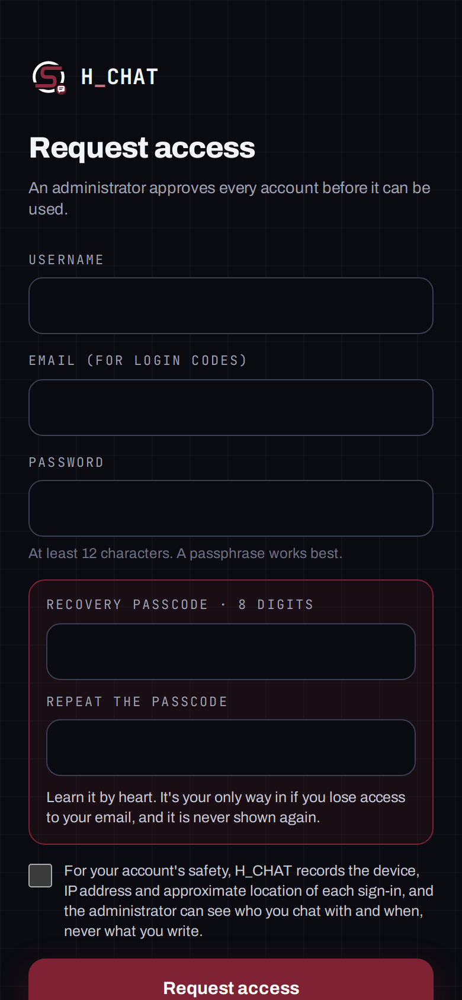 | 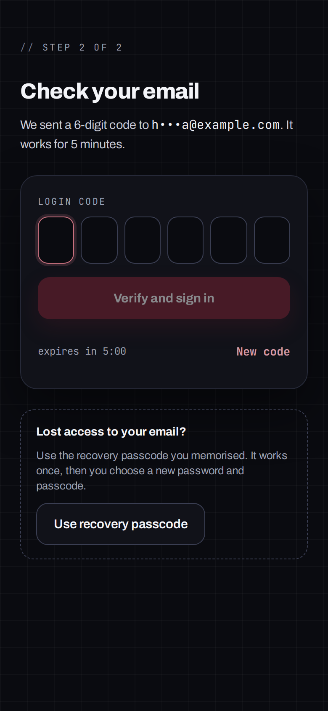 |

- **Sign in** accepts a username or email, then sends a 6-digit code by email (step 2 of 2).
- **Request access** collects username, email, password and an 8-digit recovery passcode, plus the privacy
  notice. The account waits for the administrator's approval.
- **Check your email** shows the masked address and a 5-minute countdown. Below it: the recovery passcode path.

| Hidden secure code (5 taps on the title) |
|---|
| 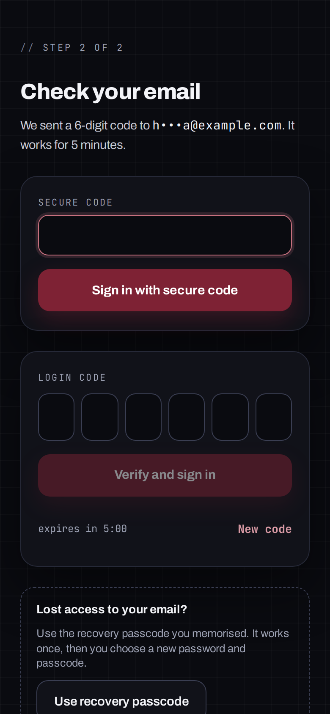 |

The secure-code field has no visible trigger on purpose: tapping the title **"Check your email" 5 times within
3 seconds** reveals it. People who set a secure code in Settings sign in with it instead of waiting for the email.

### Contacts

| Home, no contacts | Add a contact | Incoming request |
|---|---|---|
| 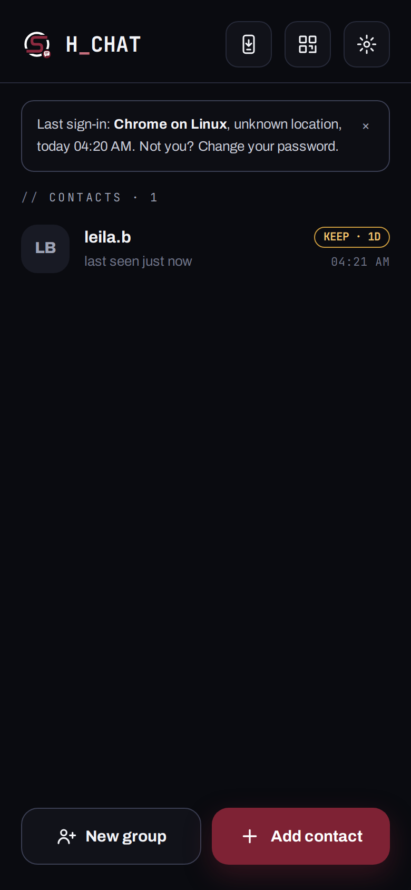 | 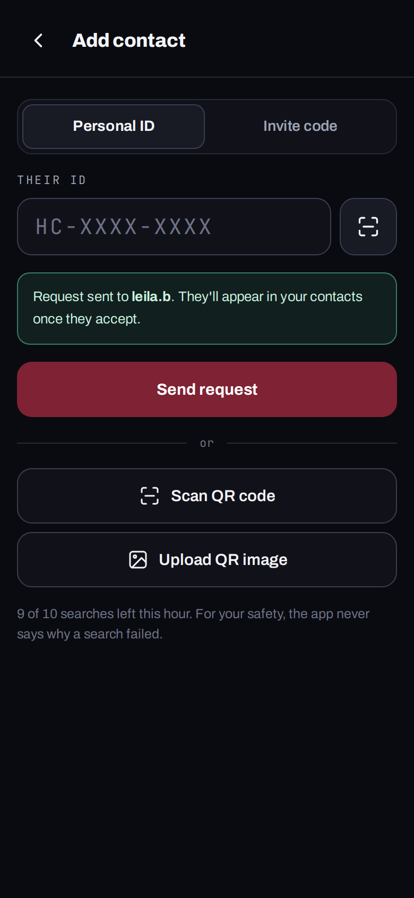 | 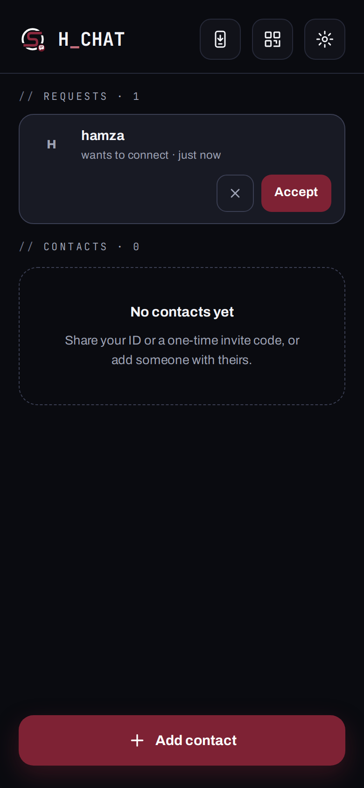 |

| Contacts | A contact | Start a chat |
|---|---|---|
| 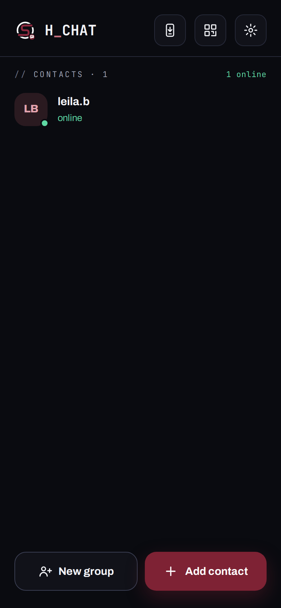 | 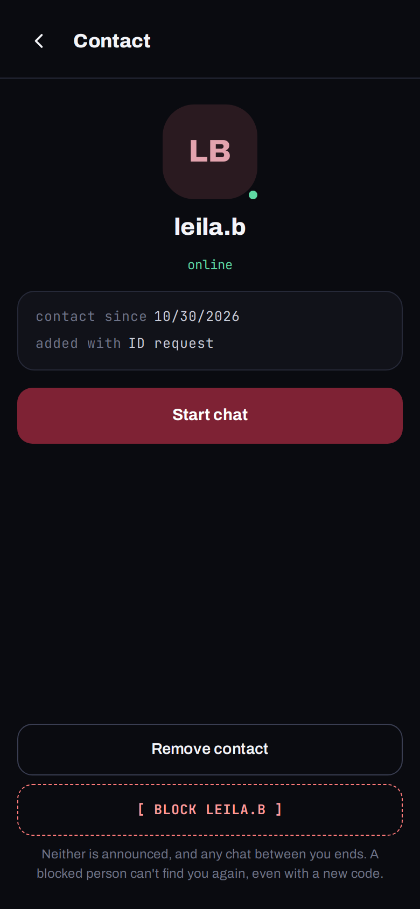 | 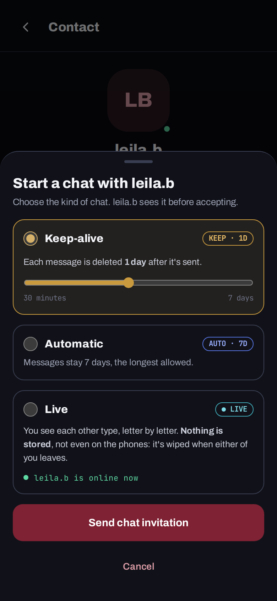 |

- The home screen is the contact list. The header holds *Get the Android app*, *My ID and invite codes*, *Settings*.
- People are added by **personal ID** (`HC-XXXX-XXXX`, QR code on Android) or a **one-time invite code** (24 h).
- Starting a chat opens a sheet listing only the modes the pair's category allows, with the retention slider.

### Chats

| Chat invitation | Stored chat |
|---|---|
| 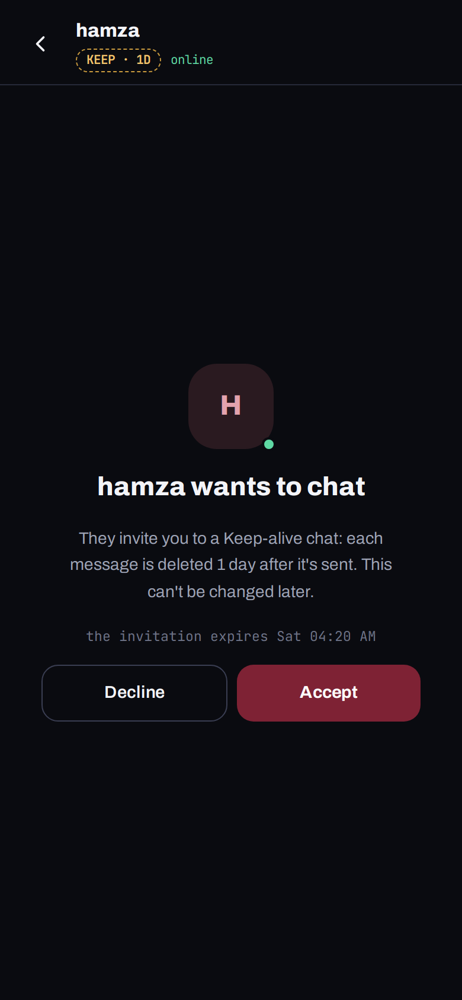 | 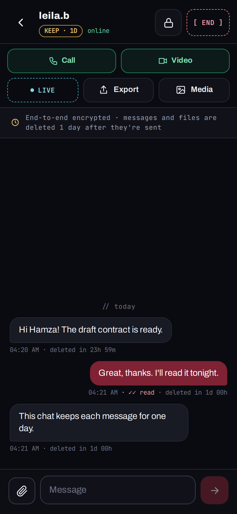 |

- The other person sees the mode and retention **before** accepting.
- In the chat: mode badge and presence, *Call* / *Video* (green), *LIVE*, *Export*, *Media*; a banner repeats the
  retention; each message shows its time, read receipt and **"deleted in …"** countdown; `[ END ]` ends the chat.

### Settings and security

| Settings | My security log | My ID |
|---|---|---|
| 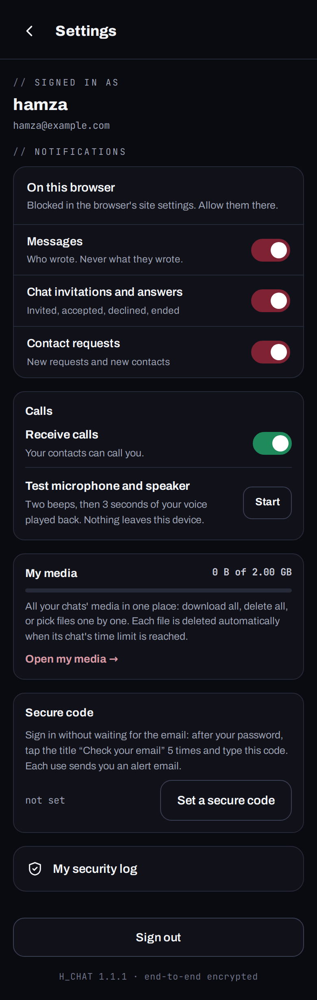 | 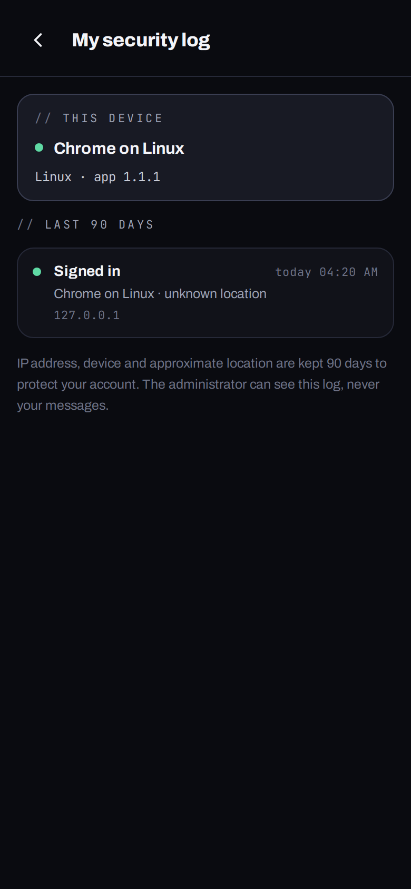 | 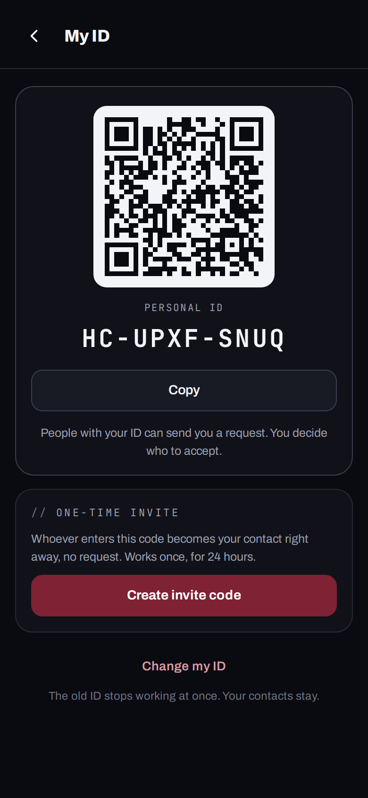 |

Settings groups notifications, calls (receive calls, microphone/speaker test), media usage, the **secure code**,
the security log (every sign-in, failure and security change with device and place) and sign-out.

## 10.4 Navigation map

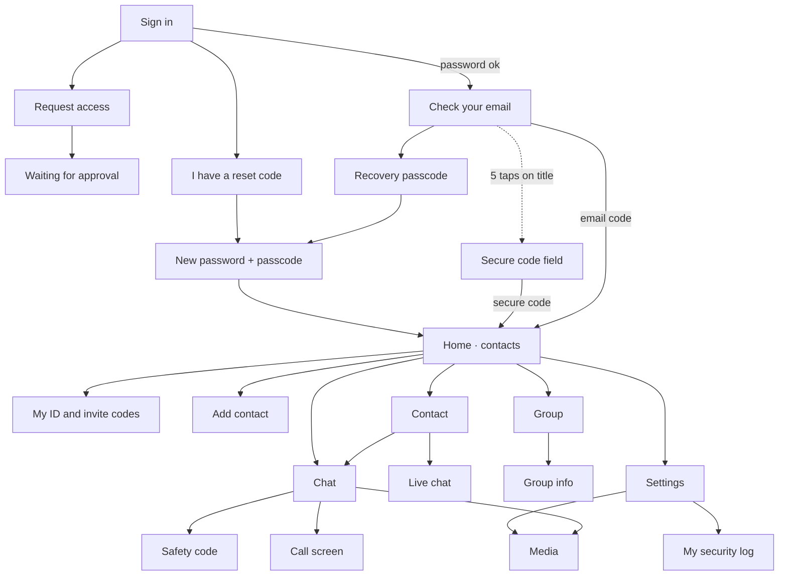

## 10.5 Key user journeys

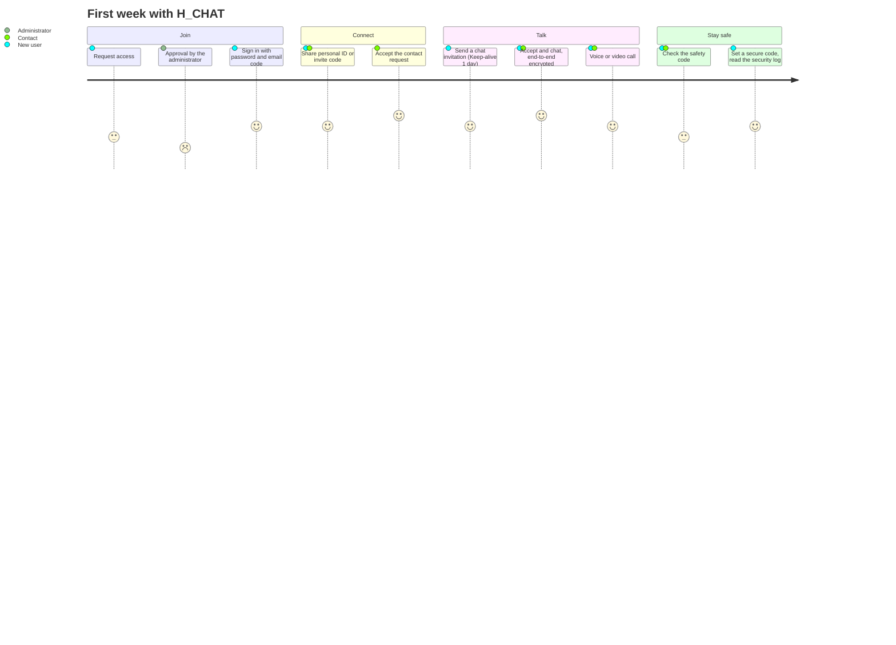

## 10.6 Accessibility and platform notes

- Every input has a visible label; icon buttons have `aria-label`s (*Settings*, *Send*, *Scan QR code*, …);
  errors use `role="alert"`; switches use `role="switch"` + `aria-checked`.
- Text contrast: `ink` and `ink-soft` on `bg`/`panel` exceed WCAG AA; `faint` is only used for secondary metadata.
- Known follow-ups (code checker warnings, `npm run lint`): some sheet backdrops close on click without a keyboard
  equivalent, some decorative SVGs lack titles, call `<video>` elements have no captions track.
- Android: view-only files block screenshots (`FLAG_SECURE`); the call service keeps calls alive with the screen off;
  notifications come from Firebase with generic texts.

## 10.7 The backoffice

Same tokens and components, desktop-first: a side menu (*Dashboard, Users, Chats (with live chats), Groups, Storage,
Categories, Activity log, Settings*) and tables with sorting. A user's page has tabs *Account & devices* (status,
categories, **secure code** switch, current device), *Contacts*, *Requests*, *Chats* (with *Delete all chat
history*, confirmed by typing the username) and *Login history*. The backoffice never shows message content.
