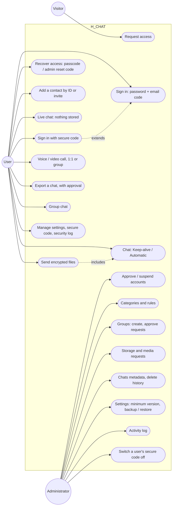
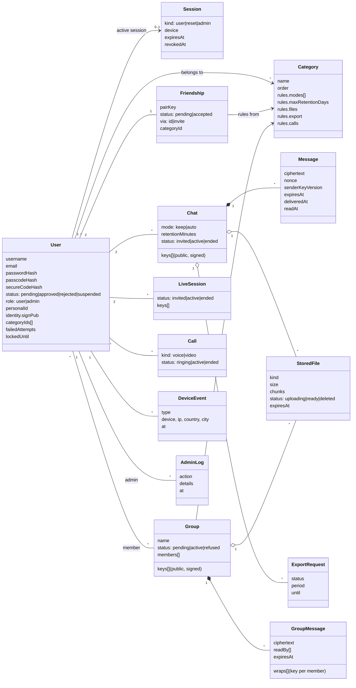
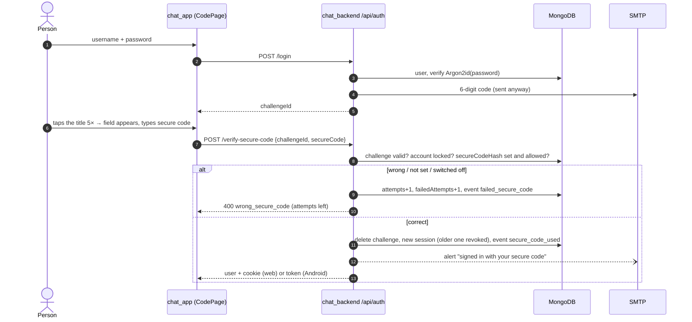
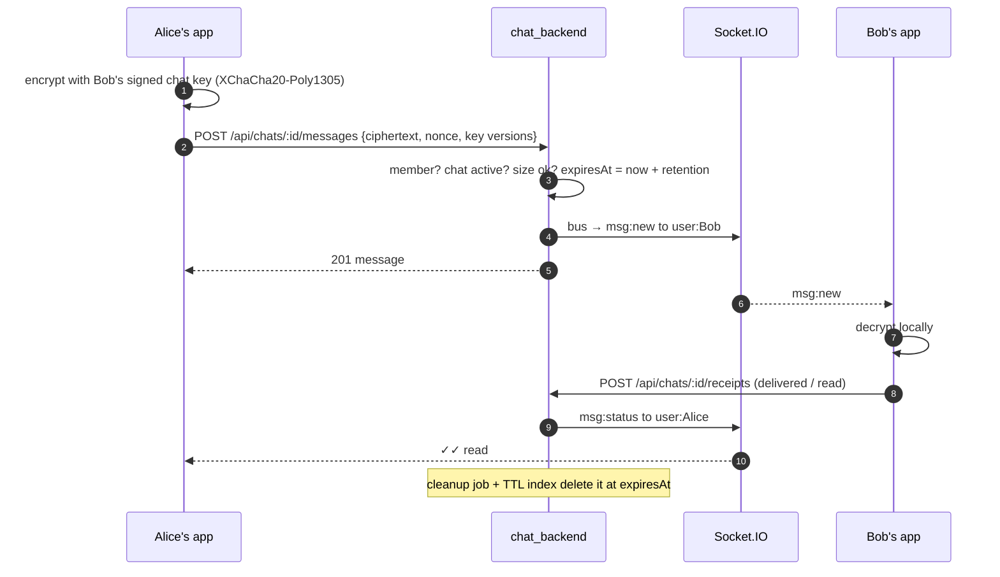
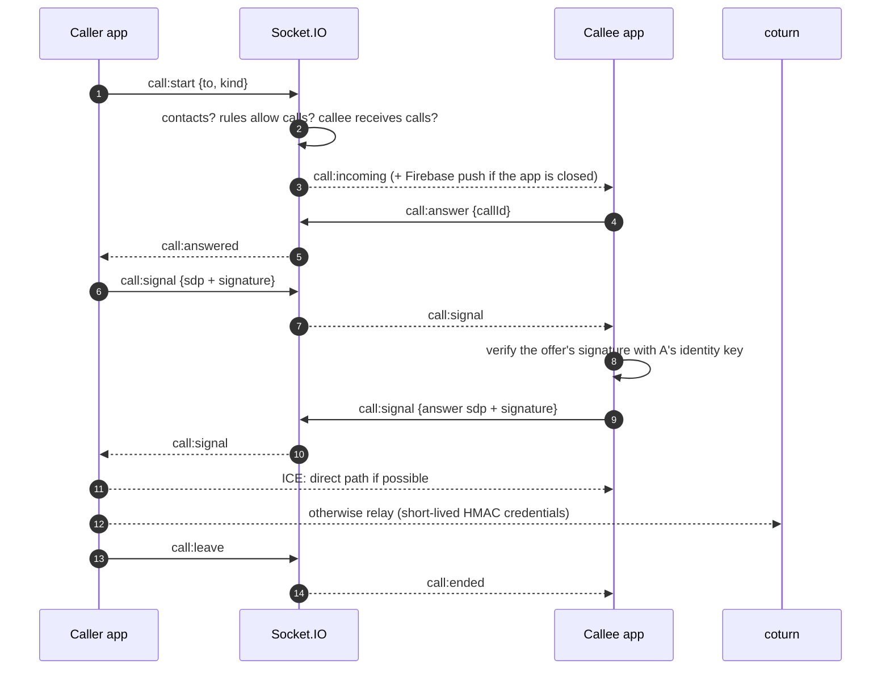
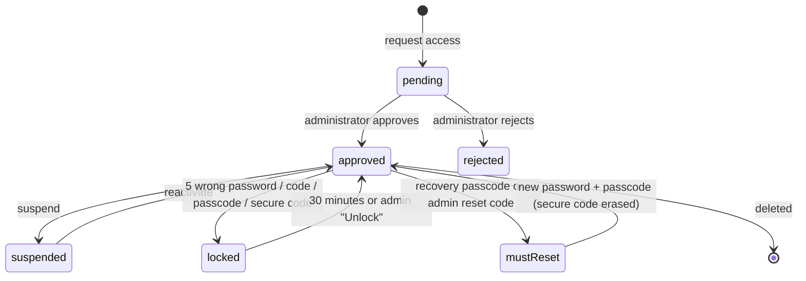
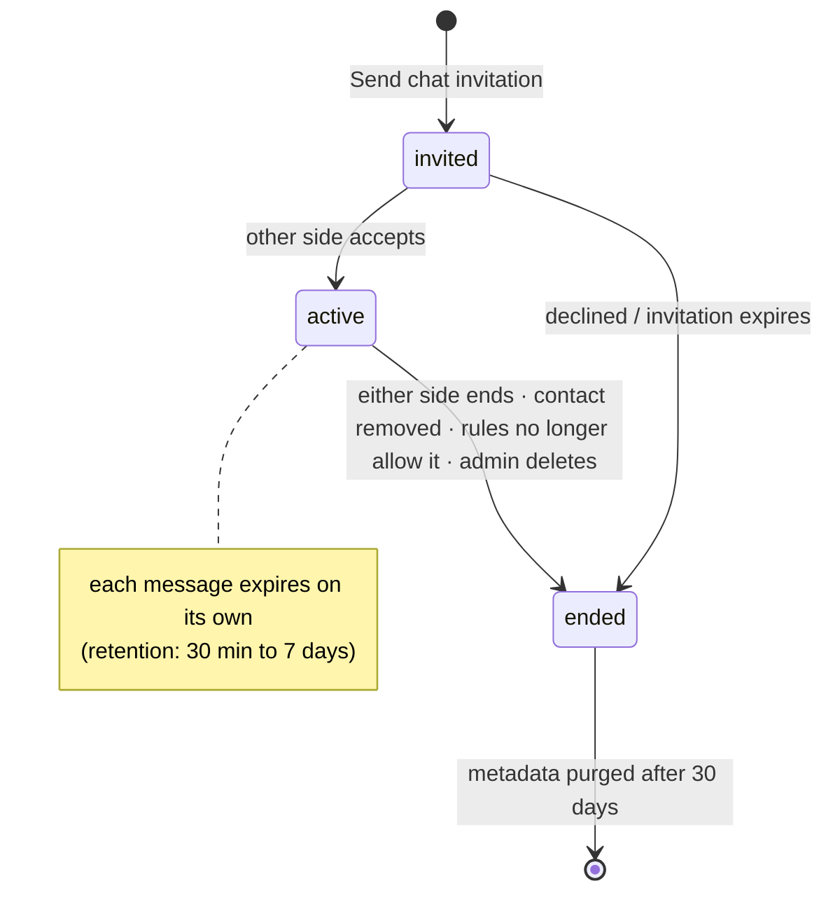
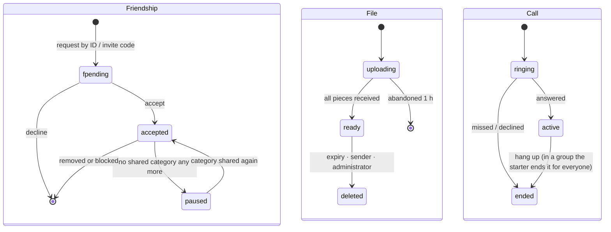
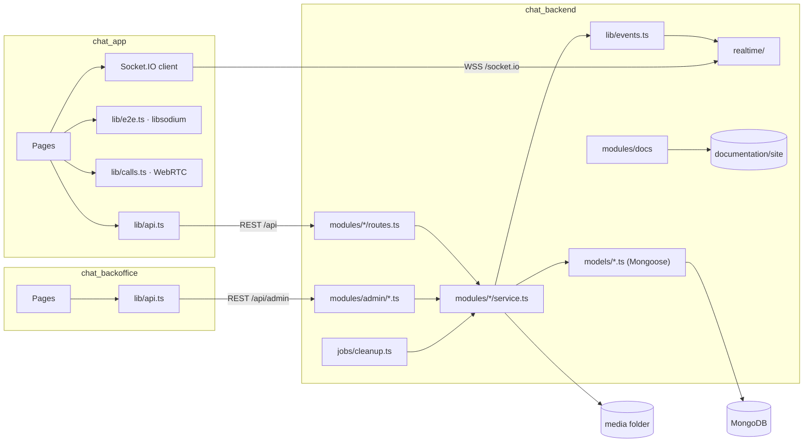
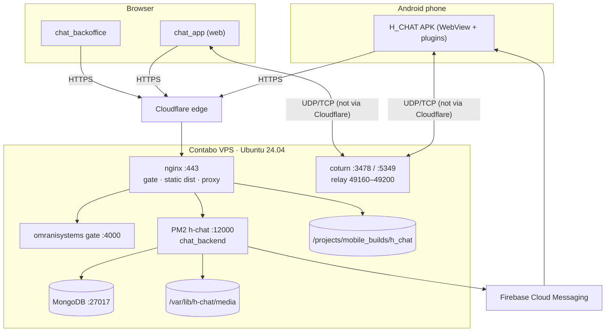

# 11. UML models

The UML views of H_CHAT, drawn with Mermaid (sources in `documentation/src/11-uml.md`). Use cases and components
use flowchart notation, since Mermaid has no dedicated use-case or component diagram.

## 11.1 Use case diagram

## 11.2 Class diagram (domain model)

The persistent classes (Mongoose models in `chat_backend/src/models/`). Field lists are shortened; every
collection is described in [Data model](12-data-model.md).

## 11.3 Sequence diagrams

### Sign-in with the secure code

### Sending a stored message

### Starting a 1:1 call

## 11.4 State machines

### Account

### Stored chat

### Contact (friendship), file, call

## 11.5 Component diagram

## 11.6 Deployment diagram

