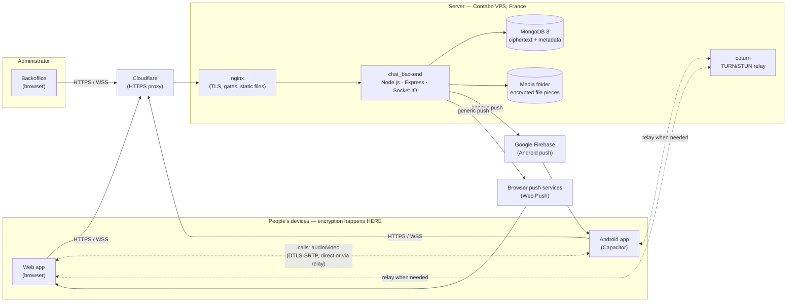

# H_CHAT — Technical documentation

**Version documented:** H_CHAT 1.1.1 (2026-10-30, tag `v1.1.1`) · first release 1.0.0 on 2026-10-18

**Audience:** developers, operators and security reviewers joining the project.

H_CHAT is a private, invitation-only messenger with end-to-end encryption. People can only join after an
administrator approves them, can only talk to contacts they added themselves, and every message, file and call
is encrypted on their own device before it leaves it. The server stores and relays scrambled data plus the
metadata it needs to work (who, when, how big), never the content.

## The documents

| # | Document | What it answers |
|---|---|---|
| 1 | [Architecture](01-architecture.md) | The three applications, how they connect, where data lives |
| 2 | [Technology stack](02-tech-stack.md) | Languages, frameworks, libraries, the call stack, noise suppression |
| 3 | [Encryption](03-encryption.md) | Keys, algorithms, where encryption happens (devices, not the server), what the server can see |
| 4 | [How chats work](04-chat-flows.md) | Sign-in, contacts, stored chats, live chats, files, groups, export — with sequence diagrams |
| 5 | [How calls work](05-calls.md) | 1:1 and group calls, WebRTC, the TURN relay, ringing, audio processing and routing |
| 6 | [Hosting and operations](06-hosting-and-operations.md) | Server, network path, ports, processes, deploys, backups |
| 7 | [Limits and capacity](07-limits-and-capacity.md) | Product limits, how many simultaneous calls, scaling plan |
| 8 | [Security](08-security.md) | Threat model, controls in place, risks ranked with recommendations |
| 9 | [API and events reference](09-api-reference.md) | Every REST route and real-time event |
| 10 | [UX and UI design](10-ux-ui.md) | Design principles, colours and type, components, every screen, navigation map, user journeys |
| 11 | [UML models](11-uml.md) | Use cases, classes, sequences, states, components, deployment |
| 12 | [Data model](12-data-model.md) | Every MongoDB collection, its fields, indexes and expiry |
| 13 | [Developer guide](13-developer-guide.md) | Set up, code map, conventions, testing, how to add a feature, releasing |
| 14 | [Operations runbook](14-operations-runbook.md) | Daily checks, symptom → cause → fix, recovery, undoing a release |
| 15 | [Versions and milestones](15-versions.md) | What each milestone and release added |

Diagrams are written in [Mermaid](https://mermaid.js.org/) inside the Markdown sources
(`chat_backend/documentation/src/`). This site is built from them: see the [Developer guide](13-developer-guide.md#137-updating-this-documentation).

## H_CHAT in one picture

## Key facts

| | |
|---|---|
| Applications | `chat_backend` (API + real-time), `chat_app` (web + Android), `chat_backoffice` (admin) |
| Repositories | github.com/HamzaOMRANII/chat_backend · chat_app · chat_backoffice (branch `main`, latest tag `v1.1.1`) |
| Addresses | chat.omranisystems.com · adminchat.omranisystems.com · turn.omranisystems.com |
| Encryption | libsodium on the devices: Ed25519, X25519, XChaCha20-Poly1305, BLAKE2b; calls: WebRTC DTLS-SRTP with signed offers |
| Server can read | Accounts, contact lists, who talks with whom and when, sizes — **not** messages, files or call audio/video |
| Hosting | One Contabo VPS (4 vCPU, 7.8 GB RAM, 96 GB disk), Ubuntu 24.04, France (Grand Est) |
| Tests | Backend 116 · App 32 · Backoffice 9 (Vitest), plus Playwright browser scenarios; `npm run check` in each repository |
